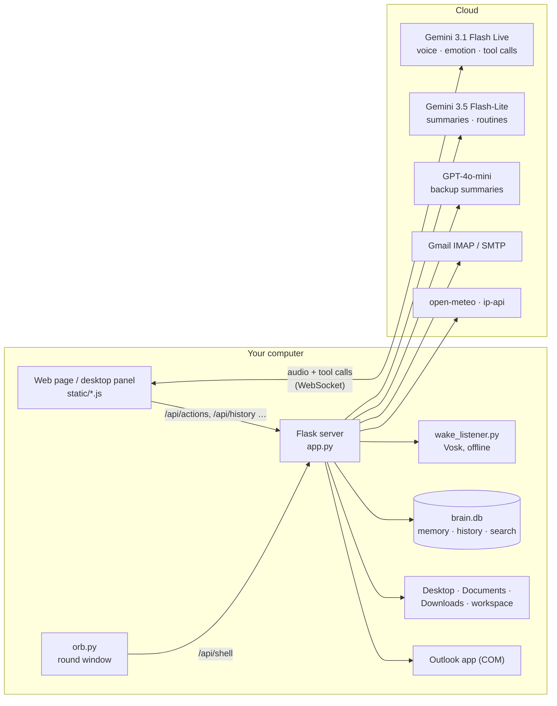
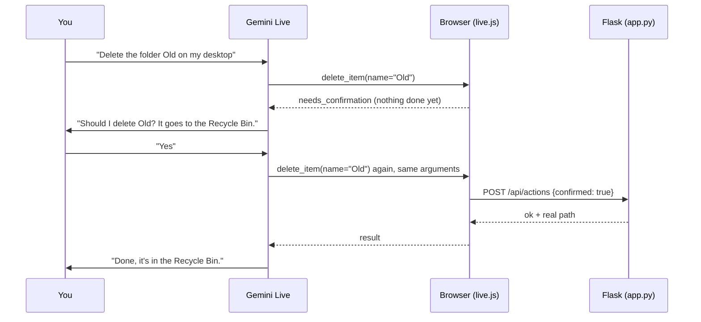

# bena — Voice Assistant for Windows 🎙️

**An emotion-aware voice assistant for your computer.** Talk to it in Hebrew or English. It
hears *how* you sound, not only what you say, answers out loud, and actually does things on
the PC: folders and files, timers, calendar, weather, email, reminders that run by
themselves. It always asks before anything risky.

It runs as a **web page** and as a **desktop app**: a small round orb in the corner of the
screen that you wake by saying *"hey gemini"*.

> Course: **Introduction to Artificial Intelligence**, final project.
> Difficulty level: **3 (advanced)**. Several AI models work together in one multimodal
> system: speech in, speech out, text and tool use. See [AI models](#3-ai-models--what-we-use-and-where).

---

## Contents

1. [The problem and the solution](#1-the-problem-and-the-solution)
2. [What it can do](#2-what-it-can-do)
3. [AI models — what we use and where](#3-ai-models--what-we-use-and-where)
4. [How it works](#4-how-it-works)
5. [Where the data is saved](#5-where-the-data-is-saved)
6. [Project structure — every file](#6-project-structure--every-file)
7. [Installation and running](#7-installation-and-running)
8. [Things to say to it](#8-things-to-say-to-it)
9. [Safety by design](#9-safety-by-design)
10. [Ethics, privacy and limitations](#10-ethics-privacy-and-limitations)
11. [Testing](#11-testing)
12. [Troubleshooting](#12-troubleshooting)
13. [Engineering lessons](#13-engineering-lessons)
14. [Tech stack](#14-tech-stack)

---

## 1. The problem and the solution

### The problem

- **Using a computer is all keyboard and mouse.** Small jobs, like setting a timer, checking
  tomorrow's calendar, creating a folder or reading new email, each mean opening an app and
  clicking through it. For people with limited mobility or vision that friction becomes a barrier.
- **Voice assistants hear words, not people.** They don't notice that you're stressed or
  frustrated. Most don't remember you between conversations, and many can't act on the PC
  itself.
- **Hebrew is a second-class language** in most assistants, both for understanding and for speaking.

### The solution

bena is a voice-first assistant that:

| Need | How bena answers it |
|---|---|
| Hands-free | Say **"hey gemini"**, and the orb turns green and says "how can I help?" Say "goodbye" and it goes back to standby |
| Understands *how* you feel | A native-audio model hears pitch, pace, volume and sighs, reports one of **10 emotions** with the evidence it heard, and adapts its own tone |
| Actually does things | **29 real tools**: files, timers, calendar, weather, location, email, memory, routines |
| Safe | Anything destructive (delete, move, rename, send, schedule) is **asked out loud first** and also enforced by the server |
| Remembers you | Long-term memory, searchable past conversations, routines that run on a schedule |
| Hebrew and English | One switch pins the spoken language. It understands either |

---

## 2. What it can do

| Area | Highlights |
|---|---|
| 🎙️ **Live voice** | Real-time spoken conversation, interruptible ("barge-in"). Live transcript. Emotion panel (emotion, confidence, energy, evidence) |
| 👂 **Wake word** | "hey gemini" (or your own phrase). Web: fuzzy phonetic matching. Desktop: offline recognition that ignores background noise |
| 🇮🇱 / 🇺🇸 **Language** | Speaks Hebrew or English; transcription is pinned to the same language |
| 🗂️ **Files** | Create folders (nested), write notes, list, file info (real dates), rename, move (into folders), delete to the Recycle Bin. Works on Desktop, Documents, Downloads and a private `workspace/` |
| ⏰ **Timers** | Run on the computer itself; the alarm pops up even if the window is closed |
| 📅 **Calendar** | Add, list and delete events (local calendar) |
| 🌤️ **Weather / 📍 location** | Current weather and a 3-day forecast for where you are, or any city |
| 📧 **Email** | Read, search and send your Gmail: directly with an app password, or through the installed Outlook app as a backup |
| 🧩 **Brain** | Memory about you, search in past conversations, skills (how-tos she writes for herself), routines ("every morning at 8, tell me the weather") |
| 🕘 **History** | Every conversation, with transcript, emotions and a one-line AI summary |
| 🧰 **Tools tab** | Switch any tool group on or off. Enforced on the server, not just hidden |
| 🩺 **Health tab** | Live check of every connection (Gemini, OpenAI, mic, folders, email, …) with fix steps |
| 🖥️ **Desktop app** | A truly round, always-on-top orb. Click it to open the panel, drag to move, right-click to quit |

---

## 3. AI models — what we use and where

| # | Model | Kind | Runs on | What it does in bena | Code |
|---|---|---|---|---|---|
| 1 | **Gemini 3.1 Flash Live**<br>`gemini-3.1-flash-live-preview` | Native audio-to-audio LLM with function calling | Google cloud. The browser talks to it directly over a WebSocket | The whole voice conversation. Hears your voice (not a transcript), **detects your emotion** (`report_emotion` tool), decides which tool to call, speaks the answer | `static/live.js`, token from `app.py` |
| 2 | **Gemini 3.5 Flash-Lite** | Text LLM with function calling | Google cloud, called from Flask | Writes the one-sentence **summary** of each conversation. **Runs routines** on a schedule as an agent with read-only tools | `app.py` (`/api/summarize`), `routines.py` |
| 3 | **OpenAI GPT-4o-mini** | Text LLM | OpenAI cloud | **Backup summariser**: writes the conversation summary when Gemini can't | `app.py` (`/api/summarize`) |
| 4 | **Vosk** `small-en-us` | Offline speech recognition (Kaldi) | Locally, on the PC | **Desktop wake word**: hears "hey gemini" without sending audio anywhere | `wake_listener.py` |
| 5 | **Web Speech API** | Browser speech recognition | Chrome / Edge | **Web wake word** | `static/wake-word.js` |

**Why this is difficulty level 3:** five models with different jobs (speech-to-speech
conversation with emotion recognition, a text agent that runs routines, a backup
summariser and two speech recognisers, one of them fully offline), combined into one
multimodal system. Audio in and out, text, and real actions on the computer.

**Why a native-audio model?** A classic pipeline (speech-to-text → LLM → text-to-speech)
throws away *how* you said something before the LLM ever sees it. Gemini Live hears the
audio itself, which is what makes emotion detection from the voice possible, and it answers
with lower latency.

---

## 4. How it works

### The big picture



The audio never passes through our server. Flask only mints a **short-lived token**, so the
API key stays on the server, and executes the tools.

### A voice conversation, step by step

1. **Start.** You click the mic or say the wake word. The page asks Flask for an
   ephemeral Gemini token (`/api/gemini-token`). The real API key never reaches the browser.
2. **Setup.** The page loads which tools are switched on (`/api/tools`) and what she
   remembers about you (`/api/brain/context`). It then opens a WebSocket to Gemini Live with
   one setup message: the instructions (language, rules, your memory, her skills) plus the
   declarations of the enabled tools.
3. **Audio.** The microphone goes through an AudioWorklet (`pcm-worklet.js`) as 16 kHz PCM
   chunks. Gemini's spoken reply (24 kHz PCM) is played back. If you start talking, it stops
   (barge-in).
4. **Emotion.** Before replying, Gemini calls `report_emotion` with the emotion, confidence,
   energy and the vocal evidence. The emotion panel updates and it adapts its tone.
5. **Tools.** When you ask for something, Gemini calls a tool. The browser sends it to
   Flask (`POST /api/actions`), Flask runs it (sandbox, switches, validation) and the result
   goes back to Gemini, which tells you what happened. Every action leaves a ✓ / ✕ receipt
   in the transcript.
6. **Saving.** Every sentence is written to `brain.db` as you talk. When the call ends, an
   AI summary is added.
7. **Goodbye.** Saying "goodbye" makes her say a short farewell and call
   `end_conversation`. She returns to standby and waits for the wake word.

### Two-phase confirmation (delete, move, rename, send email, schedule routine)



The server refuses any destructive tool without `confirmed: true` (HTTP 403), so even a
misbehaving model cannot skip the question. The "same request" check tolerates the model
re-ordering arguments; a changed target means it asks again.

### Wake word

| | Web page | Desktop app |
|---|---|---|
| Engine | Web Speech API (browser) | Vosk, offline, on the PC |
| Matching | Phonetic folding + edit distance, because recognisers mishear "hey gemini" as "hey jiminy" | Grammar with ~150 decoy words; only **final** results; the whole phrase with confidence ≥ 0.80 for "gemini" and ≥ 0.50 for "hey"; said within 2.5 s |
| Hebrew | Hebrew or English phrase | English words only (Vosk has no Hebrew model). "היי ג'מיני" *is* "hey gemini" |

On a hit, a chime plays at once, the orb turns green, and she opens with "how can I help?".

### The desktop app

`desktop.py` runs the Flask app inside its own process on a free port and starts two windows:

- **The orb** (`orb.py`): a Win32 *layered* window painted with per-pixel transparency,
  so it is truly round. Purple means idle, yellow means it heard you, green means a live
  call. Click it to open or hide the panel, drag to move, right-click to quit.
- **The panel**: the same web UI in a WebView2 window. It is **hidden, not shrunk**, when
  closed, because WebView2 can't be cut into a circle.

The orb and the panel talk through `/api/shell/*`.

### Email routing

```
send / read / search request
   ├─ Gmail app password in .env? → Gmail directly (IMAP read, SMTP send)  ✅ fully automatic
   │        └─ password wrong/revoked or Gmail unreachable → fall through ↓
   └─ Outlook app (COM) → reads normally
            └─ sending blocked (Office not activated) → opens the finished email in Gmail
               in your browser; you press Send
```

### Brain: memory, past conversations, skills, routines

*Ideas adapted from Nous Research's Hermes Agent.*

- **Memory**: two short notes, *About you* (1,375 characters) and *Her notes* (2,200).
  The Live API takes its instructions once per call, so the notes are pasted into the setup
  as a snapshot. Anything saved during a call is used from the next one. The limits force
  her to merge rather than hoard. Anything that looks like a password, key or card number
  is refused.
- **Past conversations**: SQLite full-text search with a **trigram** index, so Hebrew
  words with prefixes (לאילת → אילת) are found.
- **Skills**: `skills/<name>/SKILL.md`. Step-by-step how-tos she writes and follows. Only a
  one-line index is in the prompt; steps are loaded on demand.
- **Routines**: a scheduler thread in Flask (one per computer, via a lock file). At the
  scheduled time a separate Gemini Flash-Lite agent runs with **read-only tools** (it can
  never delete, move, rename or send) and the result pops up on screen.

---

## 5. Where the data is saved

Everything personal stays **on your computer**, in the project folder. Stopping the app,
restarting it or rebooting does not lose anything.

| Where | What | Written | How to clear |
|---|---|---|---|
| `brain.db` (SQLite), table `memory` | What she remembers about you, and her notes | When she learns something | Brain tab → ✕ |
| `brain.db`, table `history` | Every conversation: transcript, emotions with evidence, duration, language, summary | **While you talk**, every sentence | History → ✕ (also removes it from search) |
| `brain.db`, tables `sessions`, `messages`, `messages_fts` | Searchable copy of conversations | With the history | Same as above |
| `skills/<name>/SKILL.md` | Skills | When she or you create one | Brain tab → Delete skill |
| `routines.json`, `routines_feed.json` | Routines and their recent results | On change / after each run | Brain tab |
| `routines.lock` | Which bena process runs the scheduler (heartbeat) | Every 20 s | Automatic |
| `calendar.json` | Calendar events | On add/delete | Ask her, or delete the file |
| `tool_settings.json` | Tool on/off switches (missing = all on) | On change | Tools tab |
| `workspace/` | Private sandbox folder for files | When you use it | Delete the folder |
| `.env` | API keys, Gmail app password | By you | Edit the file |
| `%LOCALAPPDATA%\bena\webview` | Desktop app settings: language, wake phrase, hands-free | On change | Delete the folder |
| Browser `localStorage` | The same settings for the web page | On change | Clear site data |
| `%USERPROFILE%\.cache\vosk` | The downloaded offline speech model | Once | Delete the folder |

All of these are git-ignored except the `skills/` folder.

**What leaves the computer:** your voice (during a call) and the conversation text go to
Google's Gemini. If Gemini can't write a conversation's summary, its text goes to OpenAI instead. Your IP address goes to ip-api and
open-meteo for location and weather. Email goes to Gmail's or Outlook's servers. **Audio is
never stored**, only text.

---

## 6. Project structure — every file

### Backend (Python)

| File | What it is for |
|---|---|
| `app.py` | **The Flask server, the heart of the project.** Serves the UI. Mints Gemini Live tokens. Implements the **27 server-side tools** (file sandbox, timers, calendar, weather, location, email routing, memory/skills/routines). Enforces tool switches and confirmations. Health checks, history and brain endpoints. Starts the routine scheduler. Shell state for the desktop orb |
| `brain.py` | Memory notes (bounded, secret-refusing), the history store, searchable conversations (SQLite FTS5 trigram), skills (`SKILL.md` files) |
| `routines.py` | Schedule parser ("every day at 08:00", "weekdays at 7", "in 30m", cron), next-run maths, the scheduler thread with its lock file, and the routine runner (Gemini function-calling loop with read-only tools) |
| `mail_gmail.py` | Gmail directly with an app password: IMAP to read and search (Gmail search syntax, Hebrew), SMTP to send. Credentials re-read from `.env` on every call |
| `mail_outlook.py` | The installed Outlook app over COM: read, search (Windows search index), send. Detects a never-synced account and an unactivated Office. Compose-window fallback. Hang guard (15 s deadline) |
| `wake_listener.py` | Offline wake word for the desktop app (Vosk + microphone), with the decoy grammar and confidence rules |
| `desktop.py` | Desktop app launcher: runs Flask in-process, creates the hidden WebView2 panel, starts the orb, shows or hides the panel on orb clicks, exits cleanly |
| `orb.py` | The round floating orb: a Win32 layered window with per-pixel alpha. Colour follows the state; click, drag, right-click |

### Frontend (`static/`)

| File | What it is for |
|---|---|
| `index.html` | The page: tabs (Live Voice, Tools, Brain, Health), language bar, history sidebar |
| `live.js` | **Gemini Live client.** WebSocket, audio in and out, the system instructions (language rules, safety rules, memory, skills), all tool declarations, the two-phase confirmation logic |
| `live-ui.js` | Voice tab UI: talk button, live transcript, emotion panel, action receipts, confirm dialogs, language switch, wake-word glue, saving the conversation as it happens |
| `pcm-worklet.js` | AudioWorklet that turns microphone audio into 16-bit PCM chunks off the main thread |
| `wake-word.js` | Web wake word: Web Speech API + phonetic fuzzy matching + chimes |
| `history.js` | History sidebar and its store (backed by the database) |
| `tools.js` | Tools tab: on/off switches per tool group |
| `health.js` | Health tab: live checks, integration switches, fix steps (e.g. email) |
| `brain.js` | Brain tab: memory, routines (create, pause, run, delete), skills, past-conversation search |
| `desktop.js` | Only in the desktop app: panel title bar (history, hide, quit), Python wake-word polling, orb colour sync |
| `style.css` | Base design |
| `live.css` | Voice mode, tabs, the Tools, Brain and Health pages, the desktop panel |

### Tests (`tests/`)

| File | What it checks | Checks |
|---|---|---|
| `smoke_test.py` | Sandbox (traversal attacks), confirmations, nested moves, tool switches, Health, the voice confirmation key, frontend wiring, Outlook edge cases, memory/search/skills/routines, history. Runs on a throwaway data folder | 72 |
| `test_brain.py` | Memory limits and secrets, Hebrew search, skills, history, memory import | 35 |
| `test_routines.py` | Schedule parsing, next-run maths, scheduler, one-off routines | 39 |
| `test_wake.py` | When the desktop wake word may fire | 13 |
| `test_gmail.py` | Gmail direct against a fake mail server, and the Gmail → Outlook routing | 31 |
| `tool_check.py` | **Real end-to-end check of all 29 tools** on your actual folders, calendar, mailbox and weather. Cleans up after itself | 29 tools |

### Other

| File | What it is for |
|---|---|
| `requirements.txt` | Python packages |
| `.env` | API keys and Gmail app password (never committed) |
| `.gitignore` | Keeps personal data and keys out of git |
| `skills/morning-briefing/SKILL.md` | The starter skill |

---

## 7. Installation and running

**You need:** Windows 10/11, Python 3.12 (`py -3.12`), a microphone, Chrome or Edge.
Node.js is only needed for some tests.

```bash
# 1. install
py -3.12 -m pip install -r requirements.txt

# 2. keys: create .env in the project folder
GEMINI_API_KEY=...        # https://aistudio.google.com/apikey  (voice, summaries, routines)
OPENAI_API_KEY=...        # https://platform.openai.com          (backup summaries; required to start)

# 3a. web version
py -3.12 app.py           # then open http://127.0.0.1:5000

# 3b. or the desktop app (round orb, offline wake word)
py -3.12 desktop.py
```

The first time hands-free is switched on in the desktop app, the offline speech model
(~40 MB) downloads by itself.

**Optional: automatic email sending with Gmail (2 minutes, once)**

1. Turn on 2-Step Verification for your Google account (Google Account → Security).
2. Create a password at https://myaccount.google.com/apppasswords and name it "bena".
3. Add it to `.env`. No restart is needed:
   ```
   GMAIL_ADDRESS=you@gmail.com
   GMAIL_APP_PASSWORD=abcd efgh ijkl mnop
   ```

Without it, bena reads mail through the installed Outlook app. For sending it opens the
finished email in Gmail and you press Send.

---

## 8. Things to say to it

| English | עברית | Tool |
|---|---|---|
| "What's the weather?" | "מה מזג האוויר?" | `get_weather` |
| "Create a folder Projects/2026 on my desktop" | "תיצרי תיקייה פרויקטים בשולחן העבודה" | `create_folder` |
| "Move report.txt into Documents" | "תעבירי את report.txt למסמכים" | `move_item` (asks first) |
| "Set a timer for 10 minutes" | "תכווני טיימר ל-10 דקות" | `set_timer` |
| "What do I have tomorrow?" | "מה יש לי מחר ביומן?" | `list_events` |
| "Add a dentist appointment Sunday at 4" | "תוסיפי תור לרופא שיניים ביום ראשון ב-4" | `add_event` |
| "Any new emails?" / "Search my email for LinkedIn" | "יש לי מיילים חדשים?" | `list_emails` / `search_emails` |
| "Send an email to dana@example.com saying I'm late" | "תשלחי מייל לדנה שאני מאחר" | `send_email` (asks first) |
| "Remember that I'm a student at SCE" | "תזכרי שאני סטודנט ב-SCE" | `memory` |
| "What did I tell you about Eilat?" | "מה אמרתי לך על אילת?" | `session_search` |
| "Every weekday at 8, tell me the weather and my calendar" | "כל יום חול ב-8 תגידי לי מזג אוויר ויומן" | `schedule_routine` (asks first) |
| "Goodbye" | "ביי" / "תודה, זהו" | `end_conversation` |

---

## 9. Safety by design

| Risk | Protection |
|---|---|
| Misheard command deletes something | Two-phase spoken confirmation, **and** the server refuses without `confirmed: true` (403). Deletions go to the **Recycle Bin**, never permanent |
| AI writes outside allowed places | File sandbox: only Desktop, Documents, Downloads, `workspace/`. Rejects `..`, absolute paths, UNC shares, reserved names (`CON`…) and illegal characters, and checks the real resolved path stays inside the root |
| An email tells the AI what to do (prompt injection) | Email bodies are marked as untrusted data. Her instructions forbid following them |
| Routines acting unattended | Routines get a fixed **read-only** tool list, with a code assertion that it never includes a destructive tool |
| Secrets in memory | Passwords, API keys and card numbers are refused |
| API key theft from the browser | The key stays on the server; the browser gets a short-lived, single-use token |
| You don't want a capability | Tools tab / Health switches, enforced server-side |
| Silent failure | Every action shows a ✓ / ✕ receipt with the real path. She is instructed never to claim success that didn't happen (e.g. "sent" when it wasn't) |

---

## 10. Ethics, privacy and limitations

### Privacy

- **Voice goes to the cloud during a call.** Audio is streamed to Google's Gemini (and if
  Gemini can't summarise a conversation, its text goes to OpenAI). How the providers handle it is governed by their API terms (free
  API tiers may use data to improve products). bena never records audio itself.
- **Emotion readings are sensitive personal data.** They are shown only to you, with the
  evidence, stored only locally, and deletable. They are used only to adjust the
  assistant's tone, never to make decisions about you.
- **Everything else is local** (`brain.db`), visible in the Brain and History tabs, and
  deletable one item at a time or all at once.
- **Location** is approximate (from the IP), only looked up when asked, and can be switched off.

### Fairness and accuracy

- **Emotion recognition from voice is probabilistic.** Accents, Hebrew vs English,
  background noise, microphone quality and cultural differences in expressing emotion all
  cause mistakes. bena reports **confidence** and **evidence**, prefers "low confidence" over
  confident guessing, and only changes how it talks.
- **Transcription in Hebrew is weaker** than the model's own understanding. The on-screen
  text can be wrong even when the answer is right.

### Responsibility

- **Human in the loop** for every irreversible action, enforced in code, not just in the prompt.
- **Transparency**: receipts for every action, honest error messages, and a Health page
  that explains what is broken and how to fix it.
- **Not a therapist.** Emotional awareness is for tone, not mental-health advice.

### Technical limitations

- Needs **internet** for the conversation; only the desktop wake word works offline.
- Gemini 3.1 Flash Live is a **preview** model and can occasionally stay silent or ask twice.
- The **desktop wake word** must be English words (Vosk has no Hebrew model).
- Desktop app, Outlook and timers' pop-ups are **Windows-only**.
- **Outlook can't send while Office is not activated.** Use the Gmail app password.
- The web wake word works only in Chrome/Edge (not inside WebView2).
- The calendar is **local**, not Google or Outlook Calendar.

---

## 11. Testing

```bash
py -3.12 tests/smoke_test.py      # 72 checks, sandboxed (fake mail, temp data folder)
py -3.12 tests/test_brain.py      # 35
py -3.12 tests/test_routines.py   # 39
py -3.12 tests/test_wake.py       # 13
py -3.12 tests/test_gmail.py      # 31
py -3.12 tests/tool_check.py      # real end-to-end check of all 29 tools
```

The first five never touch your real data. `tool_check.py` uses your real folders,
calendar, mailbox and weather, names everything it creates `bena_selftest…` and removes it
again. It sends a real email only if Gmail direct is set up, and only to yourself. The
voice path was also tested against Gemini Live itself (memory, emails in Hebrew and
English, confirmations, routines).

---

## 12. Troubleshooting

| Symptom | Fix |
|---|---|
| No orb on screen | Run `py -3.12 desktop.py`. If two orbs appear, two copies are running: right-click one to quit |
| Hands-free wakes up by itself | Make sure you are on the latest version (decoy grammar). Use a phrase of ordinary English words |
| "Office isn't activated" on the Health page | Outlook can read but not send. Set up the Gmail app password (section 7) |
| "Outlook did not answer" | Outlook is showing a window (sign-in, "no Office products found"). Close it |
| Voice doesn't start | Health tab → Gemini. Check `GEMINI_API_KEY` in `.env` and the internet connection |
| Wrong language on screen | Pick the language in the top bar. Transcription follows it |

---

## 13. Engineering lessons

Real problems we hit and how they were solved:

| Problem | Cause | Fix |
|---|---|---|
| Hebrew speech transcribed as Spanish | Transcription auto-detects the language separately from the model | Pin `languageCodes` to the selected language |
| Wake word "never triggers" (web) | Recognisers mishear "gemini" (*jiminy, jeremy, germany*) | Phonetic folding + edit distance, calibrated thresholds |
| Wake word triggers on noise (desktop) | Grammar had only the wake words, so every sound became "gemini"; partial guesses counted | Decoy words, final results only, confidence rules. Measured **13/26 → 0/26** false triggers, 30/30 real hits |
| "She said she created the folder but didn't" | Talk without tools; the Desktop is redirected to OneDrive | Real tools, receipts with the real path, folder locations read from the Windows registry |
| Wrong file dates | Model guessed | `file_info` returns real filesystem dates |
| Orb had square corners | WebView2 always paints a rectangle | A separate Win32 layered window with per-pixel alpha; the panel hides instead of shrinking |
| Hidden panel stopped reacting | Chromium throttles timers in hidden pages | Orb clicks handled in Python; background throttling switched off |
| History lost on restart (desktop) | pywebview's default private browser profile is deleted on exit | History and memory moved into `brain.db`; persistent profile for settings |
| Hebrew search found nothing | Hebrew glues prefixes to words (ל, ב, ה…) | SQLite FTS5 **trigram** tokenizer |
| Email "empty inbox" that wasn't | Outlook account had never synced | Detect sync state; never report an unsynced inbox as empty |
| Email never sent | Office not activated → Outlook refuses to create mail | Detect it, explain it, Gmail compose fallback, then Gmail direct |
| Email search timed out | Scanning 18,600 email bodies took 28 s | Windows search index: **0.4 s** |
| Cancelled timer still rang | The alarm thread wasn't stopped | Keep the thread handle and cancel it (found by `tool_check.py`) |
| Asked "yes?" twice in Hebrew | The model asked on its own before calling the tool | Rule: call the tool first; the tool's answer asks the question |

---

## 14. Tech stack

- **Backend:** Python 3.12, Flask, SQLite (FTS5), google-genai, openai, pywin32 (COM), imaplib/smtplib
- **Frontend:** HTML, CSS, vanilla JavaScript, Web Audio / AudioWorklet, WebSocket, Web Speech API
- **Desktop:** pywebview (WebView2), Win32 layered window (ctypes + Pillow), Vosk + sounddevice
- **AI:** Gemini 3.1 Flash Live, Gemini 3.5 Flash-Lite, GPT-4o-mini, Vosk, Web Speech API
- **External services:** open-meteo (weather), ip-api (location), Gmail, Outlook
